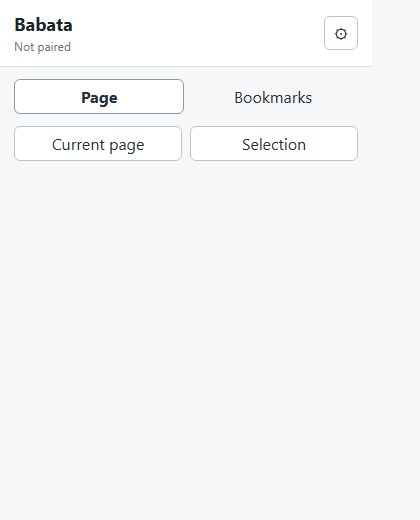

# Four-Skill Real-Task Validation

Date: 2026-10-25
Status: completed with explicit evidence limits

## Scope and protection

This run used a read-only sample from Babata and an isolated mirror under this
directory. The Babata source trees, installed Skills, `.agents` copies, Git
history, and external services were not modified. The source sample is frozen
by [source-manifest.json](source-manifest.json).

Sources copied:

- `Babata-2.0-frozen/compass-output/docs/00–05` for the product and architecture
  document chain.
- `Babata/08_adapters/01_browser_extension` manifest, package metadata, source
  entry points, tests, HTML, and CSS. `node_modules`, credentials, runtime data,
  and generated source artifacts were excluded.

## Results by Skill

| Skill | Input and action | Result | Evidence / limit |
| --- | --- | --- | --- |
| `product-docs` | Read the six Compass Output documents, their links, requirements, PRD, acceptance, architecture, process, and test cases | **passed (document-chain scope)** | The chain contains explicit read-only PublishedSnapshot boundaries, provenance, acceptance mapping, and test cases. This does not prove a running Output implementation or user acceptance. |
| `architecture` | Trace the document chain into components, data owners/writers, read-only boundaries, forbidden inputs, and verification mapping | **passed (architecture-review scope)** | Architecture identifies Core-to-Output one-way flow, data classes/writers, snapshot guard, artifact registry, and cases TC-O-01..TC-O-12. No live interface was claimed. |
| `code-quality` | In the mirror run `npm ci --ignore-scripts`, `npm run check`, `npm test`, and `npm run build`; inspect implementation and tests | **passed after bounded input repair** | First build exposed that the minimal mirror omitted `src/popup.ts`; the missing source was copied from the same read-only sample, then all gates passed: TypeScript check, 4/4 tests, and esbuild output `dist/popup.js` (14.0kb). The source code itself was not changed. |
| `design-standards` | Inspect actual `popup.html`/`popup.css`; render the initial view with local Chrome in the mirror | **partial / source-level passed** | `design-initial.png` shows visible hierarchy, controls, spacing, and no initial clipping at 420x520. Chrome APIs, pairing, candidate states, keyboard flow, responsive sizes, and interactive/error states were not exercised; therefore this is not full visual or usability acceptance. |

## Code evidence

Commands run in `work/browser-extension`:

```text
npm ci --ignore-scripts        passed; 13 packages, 0 vulnerabilities
npm run check                  passed
npm test                       passed; 4 tests, 0 failures
npm run build                  passed; dist/popup.js 14.0kb
```

The initial build failure was a mirror completeness defect (`src/popup.ts` was
not in the first copy list), not a Babata source failure. It was corrected by
copying `src/popup.ts` and `src/index.ts` from the same source tree and rerunning
the full code gate.

## Design evidence



The image is evidence only for the initial static render in the stated local
Chrome environment. It does not prove extension permissions, browser APIs,
pairing, API availability, candidate collection, or all responsive states.

## Non-results and next boundary

No real Babata API call, browser-extension installation, Output snapshot
inspector, external delivery, or product-user acceptance was performed. No
failure in those unexecuted paths is inferred. A future real-path validation
must be separately authorized and must use an isolated/removable fixture or
explicitly authorized local service.

## Reproducibility

The copied source list and SHA-256 values are in
[source-manifest.json](source-manifest.json). The working mirror is under
`work/browser-extension`; its generated `node_modules` and `dist` are local
validation outputs and are not source evidence.
